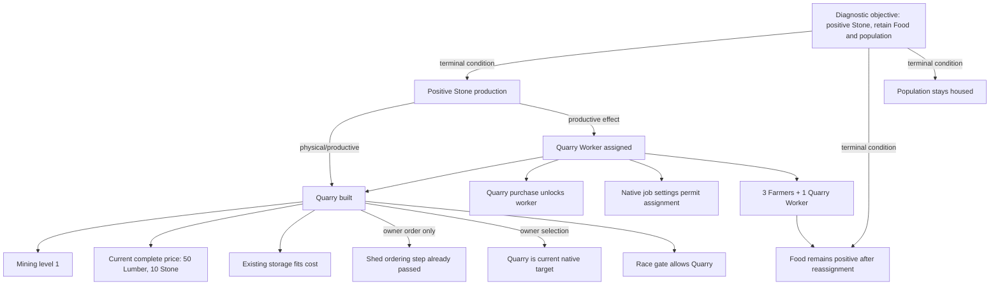

# P37 — Autonomous economic goal and dependency authority

## Decision: A — informative, diagnostic path only

Bounded native evidence identifies a plausible formula-backed route to positive Stone production while retaining population and positive Food production: keep four residents housed, employ at least three Farmers, build the currently available Quarry after meeting its complete material price, then assign one resident to the Quarry Worker. In this P36 state, the food formula projects a positive margin for that assignment. P36 stopped before Quarry ownership, so automatic reassignment and Stone output remain unestablished. This conclusion authorizes no Gather, purchase, job change, or other action.

The graph is diagnostic. Its objective has `diagnostic-objective` provenance, `playerSelected: false`, and `executionAuthority: none`. Derived needs do not become selected goals. P20's generic allocator remains retired, and no graph integration or ordinary runtime behavior changed.

## Controlled evidence and bounds

- P36 treatment C is the committed replay evidence in `experiments/p36-productive-resource-bootstrap-evidence.json`; it uses pinned game `pmotschmann/Evolve@db38e2af831907d49aeb5348d678d8d8745d6c3f`.
- P19's retained matched baseline is `experiments/p19-civilization-bootstrap-evidence.json`.
- P36 identifies `experiments/p18-standard-human-settings.json` as its settings input. Its replay harness hashes `JSON.stringify(settings)`; that canonical SHA-256 (`fa28e3da…`) matches P36's recorded digest. P37 therefore uses the settings as matched P36 policy evidence.
- Game mechanics are attributed to `test-artifacts/game/evolve-deadspace.js`, SHA-256 `05dcbca74aaf499b4b640b8bcd699038eb48e9208a253aa4f3a5f99fa0f1faf7`.
- P33 established that live Construction eligibility can be observed without requesting spending; P34 reused current native price and reservation evidence without adding catalog or price probes. P33/P34 each retained 625 shadow evaluations with zero extra native catalog/price probes. Their CPU gate remains unresolved, and P37 does not extend either runtime path.
- The graph contains 15 goals and 17 edges, with explicit limits of 20 goals and depth 6. The traversal visited all 15 nodes without a missing node, cycle, or limit hit. A smaller caller-supplied limit truncates the returned nodes and edges and reports the traversal limit.
- The builder reads retained JSON snapshots and the graph function receives a normalized 5,222-byte input. It makes no game, browser, catalog, price, or production calls.

## P36 resource contention: p584–p688

At p584, after the Shed purchase, native Construction first made Quarry current. Its complete authoritative price was **50 Lumber and 10 Stone**; stock was **0 Lumber and 0 Stone**. Queues were empty and no competing claims were observed. The Shed purchase is the boundary immediately before this episode, not a Quarry prerequisite in the physical game.

The 60 retained Quarry-stage Gather events each added one resource:

| Clicks | Periods | Resource | Added | Stock after range   |
| ------ | ------: | -------- | ----: | ------------------- |
| 1–50   | 584–656 | Lumber   |    50 | 50 Lumber, 0 Stone  |
| 51–59  | 664–672 | Stone    |     9 | 50 Lumber, 9 Stone  |
| 60     |     680 | Lumber   |     1 | 32 Lumber, 10 Stone |

The JSON artifact records every click and its post-click stock in `resourceContentionLedger.gatherActions`.

At p672, Basic Housing increased from three copies to four. The two recorded native `city-basic_housing.action` invocations correspond to one successful purchase: the building count changed by one. For a Standard Human at count three, the pinned Housing formula applies `Math.round(10 × 1.23³)`, producing **19 Lumber, 0 Stone, and 0 Money**. The immediate transaction receipt was not captured, so the attribution is reconciled from two independent facts: click #59 left 50 Lumber, and the fresh p680 pre-click stock was 31 Lumber. No Quarry Lumber Gather occurred between those observations. The 19-Lumber decrease matches the native cost exactly.

The final Quarry Gather click then added 1 Lumber, bringing stock to 32 against the 50-Lumber requirement. The resulting shortage was **18 Lumber and 0 Stone**. Housing did not consume 18 Lumber; its independently established cost was 19. The 18 is Quarry's remaining shortfall after that cost and the final +1 Lumber click.

One Stone remains unattributed. Stock rose from 9 after click #59 to 10 in the p680 pre-click observation. Click #60 was Lumber, there was no Stone Gather invocation at p680, the Housing Stone cost is zero, Quarry was not bought, and captured Stone production at p688 was zero. Surrounding p672 native Stone action records cannot be reconciled to this extra unit. The ledger marks the +1 source **unknown** rather than assigning it to Gather, passive production, or Housing.

The only native Construction purchase during the episode was that one Basic Housing. No other purchase is recorded. Irrigation research was also invoked at p672. From the post-Shed p584 state to p688, retained boundary stocks changed as follows:

| Resource  |      p584 |      p688 | Net change | Attribution limit                                                                                     |
| --------- | --------: | --------: | ---------: | ----------------------------------------------------------------------------------------------------- |
| Food      | 126.26962 | 147.64962 |     +21.38 | Boundary totals captured; separate Housing, research, and tick contributions were not isolated.       |
| Lumber    |         0 |        32 |        +32 | 51 Gathered, 19 spent on Housing; no Lumber production observed.                                      |
| Stone     |         0 |        10 |        +10 | 9 Gathered; the additional +1 is unknown.                                                             |
| Money     |     42.60 |     75.20 |     +32.60 | Boundary totals captured; production components were not isolated.                                    |
| Knowledge |     33.96 |      4.96 |        −29 | Net change captured; exact Irrigation cost versus intervening production was not separately measured. |

At p584, Food output/consumption were 3.732/3 and Lumber/Stone production were 0/0. At p688 they were 5.316/4 and 0/0. Population and capacity moved from 3/3 to 4/4; Farmer employment moved from 3 to 4. The production and consumption changes are observed, but their separate marginal causes were not established. Build and Research queues were empty, competing claims were absent in the captured Quarry observations, and the Quarry price was not reserved. The fourth Housing therefore consumed stock that native Construction was allowed to spend.

## Dependency model

The edges distinguish physical gates, a material requirement, a labor/Food requirement, and the current native owner order. **Shed is only an ordering fact in this replay.** P19 shows 200-capacity Lumber and Stone stores, both sufficient for Quarry's 50/10 cost; the pinned Quarry itself adds Stone storage after purchase. Shed's extra capacity is therefore not a physical Quarry prerequisite.

| Constraint type             | Evidence and current result                                                                                                                                                                                                                            |
| --------------------------- | ------------------------------------------------------------------------------------------------------------------------------------------------------------------------------------------------------------------------------------------------------ |
| Physical game prerequisites | The pinned Quarry requires Mining 1 and is excluded for Cataclysm and Sappy races. P36 is Standard Human with Mining 1. Quarry construction exposes the Quarry Worker and adds Stone capacity; it does not assign a worker or produce Stone by itself. |
| Owner ordering              | The P36 owner bought Shed immediately before Quarry became current at p584. The Quarry remained current after the stop. This supports “Shed step passed” and “Quarry is current” as replay ordering facts, not physical prerequisites.                 |
| Resource requirements       | Current complete Quarry price is 50 Lumber/10 Stone. At the later p944 Quarry observation, stock is 32/10, short 18 Lumber. Queues are empty and no competing claims exist, so this stock is unreserved and native Construction may use it.            |
| Labor and Food              | Four residents have capacity 4 and are all Farmers. One must be reassigned. At least three Farmers are needed to preserve positive Food in the formula-backed counterfactual.                                                                          |
| Missing/uncertain           | P36 never bought Quarry; actual autoJobs reassignment, a post-purchase Stone output sample, and stability under that assignment were not captured. The extra Stone unit in p672–p680 is unattributed.                                                  |

## Labor feasibility

The pinned Farmer formula uses one full Farm slot and farmhands for additional Farmers. With Agriculture II, the full slot contributes `0.82 + 1.15`; each additional Farmer contributes `0.82`, before the captured shared production multiplier. P36's four-Farmer output of 5.316 calibrates that multiplier to 1.2. Applying the formula at each of P36's ten retained samples from p1000 through p10000 gives the same diagnostic projection:

- Three Farmers: Food output 4.332, consumption 4, net **+0.332** at every sample.
- Two Farmers: Food output 3.348, consumption 4, net **−0.652**. This route is rejected because it does not preserve Food sustainability.
- Population remains four housed residents; the counterfactual moves a worker and removes no resident.
- One Quarry Worker has positive Stone output under the pinned Standard Human job formula. Its post-assignment amount was not measured, so this remains provisional.

The native Stone production expression is `workerScale(workers, "quarry_worker") × racialTrait(workers, "miner") × geneBonus("stonecutter") × job_data.quarry_worker.impact()`, with Quarry Worker impact 1. That formula makes a positive one-worker Stone coefficient plausible for this Standard Human case, but the actual post-purchase output amount and assignment were not captured. The graph therefore requires an observed positive Stone production sample before marking the terminal production node satisfied.

This calculation evaluates the native formula for each worker count; it does not extrapolate a universal constant difference between three and four Farmers. It is a bounded counterfactual, not a mutation experiment or production authority. P36 actually held four Farmers at all ten samples, with Food output 5.316, consumption 4, no starvation, and no deaths. The three-Farmer projection is stable across those samples if the same modifiers and assignments persist; that reassignment was not replayed.

P36's canonical settings digest matches the retained P18 settings JSON, so its current settings are authenticated: `autoJobs: true`, `jobSetDefault: true`, both jobs enabled, Quarry Worker priority 8, Farmer priority 5, Quarry Worker breakpoints `[4, 10, 0]`, and Farmer breakpoints `[-1, -1, -1]`. The managed-job rule sorts lower priorities first, so Farmer precedes Quarry Worker; the captured adapter normalizes `-1` breakpoints to an unbounded cap. These settings do not establish whether autoJobs will reassign one of the four current Farmers after Quarry appears; the priority order may retain all four Farmers. The graph marks the settings prerequisite satisfied with provisional confidence, while assignment remains unsatisfied. The formula-backed labor route remains plausible, but no post-assignment Stone production run was observed.

## Strategy comparison

The graph reuses `compareGoalStrategies` for the Quarry price target. It does not rank candidates unless all needed costs, preconditions, marginal effects, and freshness are available.

| Diagnostic strategy                              | Result                    | Why                                                                                                                                                                                                                                        |
| ------------------------------------------------ | ------------------------- | ------------------------------------------------------------------------------------------------------------------------------------------------------------------------------------------------------------------------------------------ |
| Wait for native progression without new Gather   | `uncertain`, not rankable | Captured post-stop Lumber and Stone production are zero in the observed state. A single observed production sample does not establish a future ETA; native owner behavior could still change.                                              |
| Gather toward the current Quarry saving target   | `unavailable`             | P36 exhausted the 60-click Quarry-stage budget with an 18-Lumber shortfall. No additional Gather authority or executable action is inferred. Existing click increments do not establish ongoing production or a rankable long-term policy. |
| Establish housing/population capacity first      | `unavailable`             | The fourth Housing was already purchased as a native side effect. Its 19-Lumber cost is known, but its isolated marginal effects and a separate Housing-first strategy were not captured. Housing is not a physical Quarry prerequisite.   |
| Establish a productive Lumber or Stone job first | `unavailable`             | Same-state job prerequisites, acquisition costs, labor displacement, and marginal output are missing. Quarry Worker production also requires Quarry first, so it cannot bootstrap Quarry's initial material cost.                          |

None is ranked. The comparison marks “wait” provisional/uncertain and the other candidates unavailable; it does not turn the incomplete evidence into an infeasibility claim. Lumber and Stone are both unavailable as passive bootstrap production in the captured state. The near-term Lumber material shortfall is an acquisition problem, while the Shed step is an owner-policy constraint.

## Performance and integration boundary

The offline builder warmed the pure analysis 100 times, then measured 5,000 calls as 50 batches of 100 using Node's monotonic `performance.now()` clock. Each call builds the bounded graph, compares strategies, and evaluates the A/B evidence gate. In the recorded run, the median batch-average time was 0.0570 ms per call, p95 was 0.1014 ms, the maximum batch average was 0.1316 ms, and the batches summed to 317.9 ms. The three JSON inputs total 23,867,460 bytes (P19 1,097,524; P36 22,635,310; P18 settings 134,626). The normalized graph input is 5,222 bytes. The pinned game source is 6,003,050 bytes; its SHA-256 matches the P36 game digest and is recorded as mechanics provenance.

Those timings cover only pure offline analysis; they do not measure browser/runtime integration or resolve the 2% CPU gate. The graph is not imported by ordinary runtime code. No native catalog draw, price probe, tab discovery pass, or production callback was added.

To establish actual production, a separate isolated pinned replay would need at least 18 additional one-unit Lumber Gather actions beyond P36's exhausted Quarry-stage budget, with any native Construction diversion recorded; then it would need one current Quarry price/authority observation after purchase, the native job assignment result, and a post-assignment Stone/Food sample. Repeated post-assignment samples would be needed to claim empirical interval stability. The P36 full 10,000-period run used 139 Gather actions, 688 validation fences, and 899 fresh price probes; those are context for a full replay, not costs of this offline analysis. P37 did not run another pinned replay because it adds no production behavior and the retained P19/P36 evidence answers the bounded diagnostic question.

## Artifacts and verification

- Machine-readable graph, provenance, strategy comparison, performance, labor counterfactual, and full Gather ledger: `experiments/p37-economic-goal-dependencies.json`.
- Deterministic offline builder: `experiments/p37-economic-goal-dependencies-exact.mjs`.
- Focused graph, feasibility, freshness, boundedness, immutability, and incomplete-evidence regressions: `tests/domain/progression/economic-goal-dependencies-test.mjs`.

Verification passed: focused economic-goal tests, `npm run build`, Chromium contracts (`node tools/chromium-evolve-runner-test.mjs`), all five stages of `npm run check` (367 test files), and `git diff --check`. No pinned replay was required because P37 only reads retained evidence and adds no runtime behavior.
